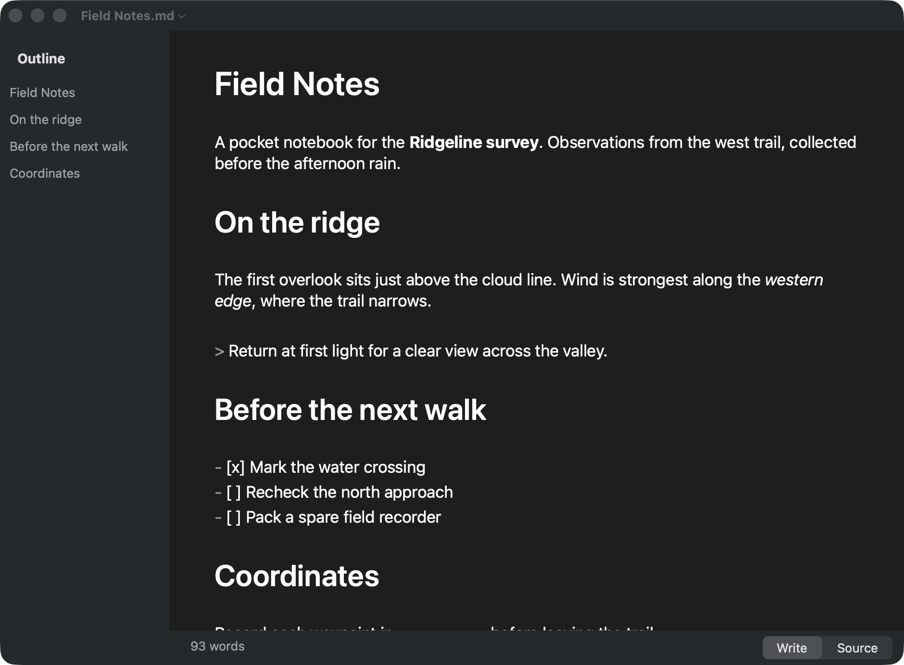

# Folio

Open a Markdown file, edit it visually, and save it in place. Folio is an Apple Silicon Mac app written in Rust, using the native AppKit text editor and document system.



## Build and run

On an Apple Silicon Mac, install Xcode Command Line Tools and a stable Rust toolchain with Cargo (Rust 2024 edition). From the project directory, run:

```sh
./build.sh
open target/Folio.app
```

Use **File → Open** to open a UTF-8 Markdown document and **⌘S** to save. Use **Format** to apply headings, emphasis, lists, and quotes. **⌘/** switches between Write and [Source view](screenshots/source.png). The outline jumps to headings. Tables and images remain editable as source.

See [contributing](CONTRIBUTING.md) for development checks. Folio is [MIT licensed](LICENSE).

## Package for macOS

Run `./package.sh` on Apple Silicon to build a versioned disk image in `target/`. Open the image and drag Folio into Applications. The package includes the MIT license. Local builds use an ad hoc signature. Set `SIGN_IDENTITY` to a Developer ID Application identity to sign the packaged app. Notarization is a separate release step.

## How it works

Folio keeps one editable string containing the original Markdown. Folio applies fonts, colors, and paragraph spacing directly to ranges of that string. Write mode gives recognized headings and emphasis their visual styling. Source mode displays the same characters in monospace. Switching views never converts the document through HTML.

Start with [the editing rules](src/lib.rs). These ordinary Rust functions recognize Markdown markers, preserve the document’s UTF-8 encoding and line endings, and translate AppKit selections into Rust string offsets. Run `cargo test --lib` to exercise them without a window.

Follow an edit through [the document controller](src/document.rs). Pressing **⌘1** replaces the current line’s block prefix, then the text view delegate restyles the same string. Saving serializes that string through the system document framework. [The window](src/window.rs) and [application menus](src/main.rs) use the `objc2` Rust bindings to AppKit.

Try typing `Field notes`, pressing **⌘1**, then **⌘/**. The source shows `# Field notes`. Save with **⌘S** and open the file in another text editor to see those same characters.
