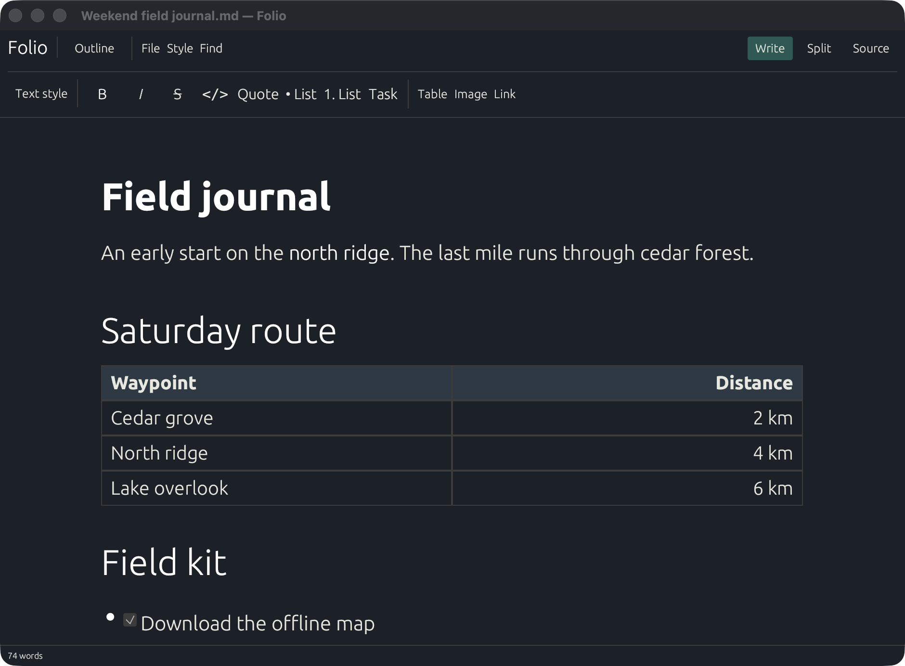
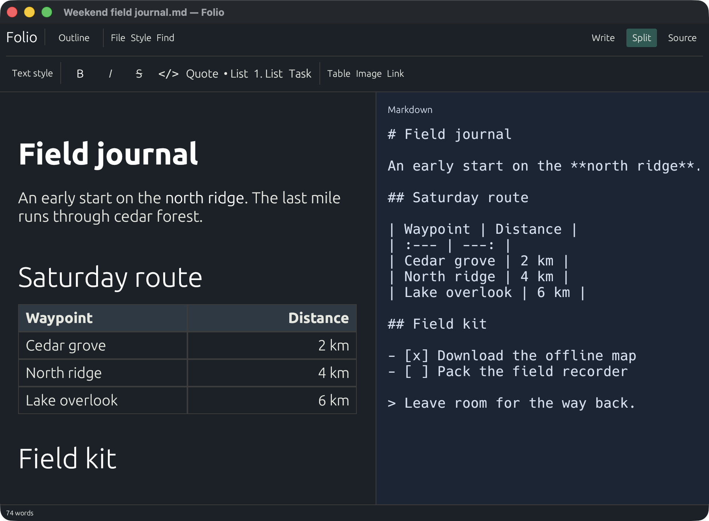

<p align="center"></p>

<h1 align="center">Folio</h1>
<p align="center">A tiny, offline Markdown editor for macOS, Windows, and Linux.</p>
<p align="center"><a href="https://github.com/alexgtmbot/folio/releases/latest"></a> <a href="https://github.com/alexgtmbot/folio/actions/workflows/check.yml"></a> <a href="LICENSE"></a></p>

Open a file, format it as you write, and save ordinary Markdown. Folio runs in its own window and keeps your documents on your computer.

**[Download Folio](https://github.com/alexgtmbot/folio/releases/latest)** · Apple Silicon disk image (signed and notarized), Windows x64 ZIP, or Linux x64 archive with build provenance.

## Around the editor

| Write | Split |
| --- | --- |
| [](screenshots/visual-editor.png) | [](screenshots/visual-split.png) |
| Choose a heading in **Outline** to jump to that section. Use the formatting toolbar to style the current line or selection. | Switch modes in the toolbar to see the characters Folio saves, including heading markers, emphasis, and tasks. |

## Run from source

Install stable Rust and the C linker for your platform (Xcode Command Line Tools on macOS, Visual Studio C++ Build Tools on Windows). On Ubuntu, install the build prerequisites:

```sh
sudo apt install build-essential pkg-config libxkbcommon-dev libxkbcommon-x11-0 libwayland-dev libgl1-mesa-dev libx11-dev libxcb1-dev libxcursor1 libxi6 libxrandr2
```

From this checkout, run `cargo run --release --locked`. To open an existing document at startup, append `-- path/to/notes.md`. The first build downloads dependencies. The installed editor works offline. On Linux, provide a Wayland or X11 desktop, OpenGL, and a desktop file-picker portal. The X11 backend requires libxkbcommon-x11 (on Ubuntu, `libxkbcommon-x11-0`).

## Editing

Open local files through **File → Open** or drag them into the window. Each document has its own tab. **Write** opens a single writing canvas. Choose **Split** to write visually beside the live Markdown output, **Source** for literal Markdown, or **Outline** to navigate headings. The preview renders nested lists, tables, task lists, fenced code, blockquotes, links, local images, strikethrough, footnotes, and definition lists. Raw HTML is displayed as text. The outline jumps to headings, and Find selects the next occurrence.

Choose **Text style → Heading 1** and type, or start a line with `# `. Write draws the heading in place. Select words and choose **Bold**, or type paired emphasis markers. **Style** controls appearance, text size, and page width. These preferences stay outside the document. Click a rendered task checkbox to update its Markdown checkmark.

In Write or Split, select words and paste an HTTP or HTTPS URL to link them. Select words and press **⌘K** (Ctrl+K on Windows and Linux) to add a URL. **Image** accepts alternative text and a local image path. The same forms open from `/link` and `/image`.

Drop a PNG, JPEG, GIF, or WebP onto the editor to insert it at the caret. **⌘V** (Ctrl+V on Windows and Linux) also accepts clipboard images and copied image files. Folio saves pasted pixels as PNG and copies external images into a sibling folder such as `Field notes.assets/`. Images already inside the note’s directory are linked in place. For a new note, choose a save location when prompted. Keep the image folder with the Markdown file when sharing.

In **Write**, press Enter between words in an ordinary paragraph to split it into two Markdown paragraphs. Folio inserts the blank line for you. Press Shift+Enter within paragraph text to start a new line in the same paragraph. Bold and italic carry across the split when the caret is inside styled text. For example, splitting **Café noir** between the words saves:

```markdown
**Café**

**noir**
```

To build a list visually, choose **• List**, type an item, and press Enter for the next one. Tab nests the current item under its previous sibling. Shift+Tab brings it back one level. Enter on an empty nested item continues the parent list. Enter on an empty top-level item ends the list.

Choose **Table**, or type `/table` and press Enter. Click a cell to edit it. Tab moves forward and Shift+Tab moves backward across row boundaries. Tab from the last cell adds a row. Right-click a cell to insert or remove rows and columns or change column alignment. Press Escape to return to the rendered table, or ⌘Enter (Ctrl+Enter on Windows and Linux) to write below it. You can also paste a GitHub-style pipe table and edit it in the same grid. [See the table editor](screenshots/table.png).

### Working with the development build

- **Paste spreadsheet cells.** Click the destination cell and paste tab-separated text. Folio fills cells to the right and down, adding columns and rows as needed. Existing values in the pasted area are replaced. A quoted line break within a cell becomes a space so the saved Markdown table stays valid.
- **Write a code block.** Select existing lines and choose **Text style → Code block**, or type `/snippet` to start an empty one. From inside a top-level fenced block, press ⌘Enter (Ctrl+Enter on Windows and Linux) to write a paragraph below it. Folio closes an unfinished fence for you.
- **Quote a passage.** Select one or more paragraphs and click **Quote**. Headings and lists keep their formatting inside the quote. While writing a quote, press Enter to continue it. Press Enter on an empty quoted line to leave one nesting level. [Quoted heading and list](screenshots/quoted-list.png)
- **Add a footnote.** At the start of a line, type `/footnote` and press Enter. Folio inserts a reference and a matching definition with an unused number. Start typing to fill in the note.

The test suite checks the parser against all 652 examples in CommonMark 0.31.2 and exercises the preview for each example. Tables, tasks, footnotes, definition lists, and strikethrough are extensions. HTML is inert and remote images are disabled.

In Write mode, type **/** at the beginning of a line and filter by name or alias (for example, **/table**, **/grid**, **/checkbox**, or **/h2**). Use ↑ or ↓ to select, Enter or Tab to insert, or Escape to keep the literal text. Slash commands are disabled inside code blocks. [See the command menu](screenshots/commands.png).

| Command | Mac | Windows / Linux |
|---|---|---|
| Follow web link at caret | ⌥⌘K | Ctrl+Alt+K |
| Open / Save | ⌘O / ⌘S | Ctrl+O / Ctrl+S |
| Undo / Redo | ⌘Z / ⇧⌘Z | Ctrl+Z / Ctrl+Shift+Z |
| Nest / outdent current list item | Tab / Shift+Tab | Tab / Shift+Tab |
| Move selected blocks up / down | ⌥⌘↑ / ⌥⌘↓ | Ctrl+Alt+↑ / Ctrl+Alt+↓ |
| Toggle Split | ⌥⌘P | Ctrl+Alt+P |
| Write / Source | ⌘/ | Ctrl+/ |
| Numbered / bullet list | ⇧⌘7 / ⇧⌘8 | Ctrl+Shift+7 / Ctrl+Shift+8 |
| Heading | ⌘1–6 | Ctrl+1–6 |
| Bold / Italic | ⌘B / ⌘I | Ctrl+B / Ctrl+I |
| Toggle task | ⇧⌘T | Ctrl+Shift+T |

Named documents autosave after two idle seconds. New documents ask for a destination when saved. If a file changes on disk, Folio stops the save and lets you save a separate copy. Unsupported Markdown syntax stays in the file.

## How it works

Each tab owns a `Document`. Its `text: String` holds the Markdown that will be saved. In Write mode, selecting a word and pressing Bold inserts `**` on either side of the word. The visual layout hides those delimiters and draws the word in bold. Split view shows both representations of the same string. [Editor](src/main.rs) · [Formatting and saving](src/document.rs) · [Visual layout](src/window.rs)

Rust strings contain UTF-8 bytes. The caret counts characters, so the document code converts the selection to byte offsets before editing. For example, `é` occupies two bytes but advances the caret by one character. On save, Folio restores the file’s line-ending convention and optional UTF-8 byte-order mark, then replaces the destination using a temporary file in the same directory. [File format](src/lib.rs) · [Document](src/document.rs)

Run `cargo test --locked` for the editing and file tests. Run `cargo run --release --locked -- --self-test` to exercise both editor layouts and a disk round trip. On Apple Silicon, `./package.sh` builds a drag-to-Applications disk image. Linux and Windows packages include the executable and licenses.

[Contributing](CONTRIBUTING.md) · [MIT license](LICENSE) · [Ubuntu font license](assets/fonts/UFL.txt)

## From GTM.bot

[](https://askwinnie.app) [](https://withmarsha.app) [](https://betaflow.app) [](https://gtm.bot)
