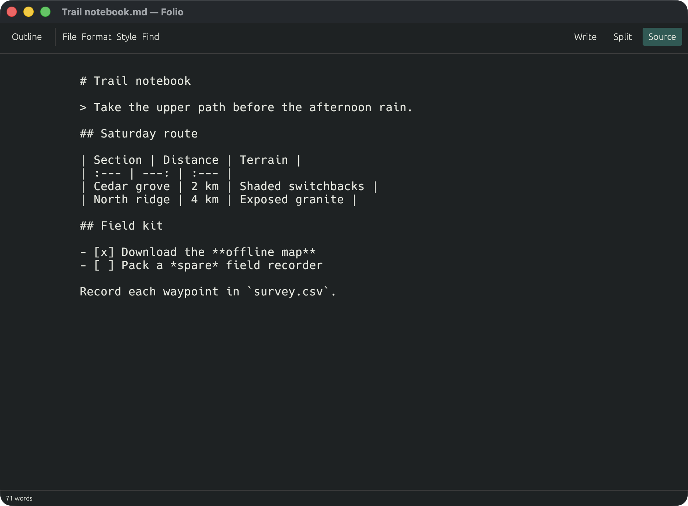

<p align="center"></p>

<h1 align="center">Folio</h1>
<p align="center">A tiny, offline Markdown editor for macOS, Windows, and Linux.</p>
<p align="center"><a href="https://github.com/alexgtmbot/folio/releases/latest"></a> <a href="https://github.com/alexgtmbot/folio/actions/workflows/check.yml"></a> <a href="LICENSE"></a></p>

Open a file, format it as you write, and save ordinary Markdown. Folio runs in its own window and keeps your documents on your computer.

**[Download Folio](https://github.com/alexgtmbot/folio/releases/latest)** · Apple Silicon disk image (signed and notarized), Windows x64 ZIP, or Linux x64 archive with build provenance.

## Around the editor

| Write | Source |
| --- | --- |
| [](screenshots/write.png) | [](screenshots/source.png) |
| Choose a heading in **Outline** to jump to that section. Use **Format** to style the current line or selection. | Switch modes in the toolbar to see the characters Folio saves, including heading markers, emphasis, and tasks. |

## Run from source

Install stable Rust and the C linker for your platform (Xcode Command Line Tools on macOS, Visual Studio C++ Build Tools on Windows). On Ubuntu, install the build prerequisites:

```sh
sudo apt install build-essential pkg-config libxkbcommon-dev libxkbcommon-x11-0 libwayland-dev libgl1-mesa-dev libx11-dev libxcb1-dev
```

From this checkout, run `cargo run --release --locked`. To open an existing document at startup, append `-- path/to/notes.md`. The first build downloads dependencies. The installed editor works offline. On Linux, provide a Wayland or X11 desktop, OpenGL, and a desktop file-picker portal. The X11 backend requires libxkbcommon-x11 (on Ubuntu, `libxkbcommon-x11-0`).

## Editing

Open local files through **File → Open** or drag them into the window. Each document has its own tab. **Write** opens a single writing canvas. Choose **Split** for a live CommonMark preview, **Source** for literal Markdown, or **Outline** to navigate headings. The preview renders nested lists, tables, task lists, fenced code, blockquotes, links, local images, strikethrough, footnotes, and definition lists. Raw HTML is displayed as text. The outline jumps to headings, and Find selects the next occurrence.

Choose **Format → Heading 1** and type, or start a line with `# `. Write draws the heading in place. Select words and choose **Bold**, or type paired emphasis markers. **Style** controls appearance, text size, and page width. These preferences stay outside the document. Click a rendered task checkbox to update its Markdown checkmark.

Select words and press **⌘K** (Ctrl+K on Windows and Linux) to add a URL. **Format → Insert image** accepts alternative text and a local image path. The same forms open from `/link` and `/image`.

Choose **Format → Insert table** or type `/table` and press Enter. Click a table to edit its cells, use Tab to move between fields, and choose **+ Row** or **+ Column** to expand it. A typed or pasted GitHub-style pipe table opens the same grid. Source shows the saved pipe syntax. Escape returns to the rendered table. [See the table editor](screenshots/table.png).

The test suite checks the parser against all 652 examples in CommonMark 0.31.2 and exercises the preview for each example. Tables, tasks, footnotes, definition lists, and strikethrough are extensions. HTML is inert and remote images are disabled.

In Write mode, type **/** at the beginning of a line and filter by name (for example, **/table**). Use ↑ or ↓ to select, Enter or Tab to insert, or Escape to keep the literal text. Slash commands are disabled inside code blocks. [See the command menu](screenshots/commands.png).

| Command | Mac | Windows / Linux |
|---|---|---|
| Open / Save | ⌘O / ⌘S | Ctrl+O / Ctrl+S |
| Undo / Redo | ⌘Z / ⇧⌘Z | Ctrl+Z / Ctrl+Shift+Z |
| Write / Source | ⌘/ | Ctrl+/ |
| Heading | ⌘1–6 | Ctrl+1–6 |
| Bold / Italic | ⌘B / ⌘I | Ctrl+B / Ctrl+I |
| Toggle task | ⇧⌘T | Ctrl+Shift+T |

Named documents autosave after two idle seconds. New documents ask for a destination when saved. If a file changes on disk, Folio stops the save and lets you save a separate copy. Unsupported Markdown syntax stays in the file.

## How it works

[The editor](src/main.rs) feeds one editable string to egui. [The layout code](src/window.rs) styles that string while preserving character positions for the caret. [The document code](src/document.rs) translates selections to UTF-8 byte offsets, edits Markdown, and uses a temporary file in the destination directory for atomic replacement. [The Markdown rules](src/lib.rs) handle block prefixes, inline formatting, code fences, BOMs and line endings.

Run `cargo test --locked` for the editing and file tests. Run `cargo run --release --locked -- --self-test` to exercise both editor layouts and a disk round trip. On Apple Silicon, `./package.sh` builds a drag-to-Applications disk image. Linux and Windows packages include the executable and licenses.

[Contributing](CONTRIBUTING.md) · [MIT license](LICENSE) · [Ubuntu font license](assets/fonts/UFL.txt)

## From GTM.bot

[](https://askwinnie.app) [](https://withmarsha.app) [](https://betaflow.app) [](https://gtm.bot)
